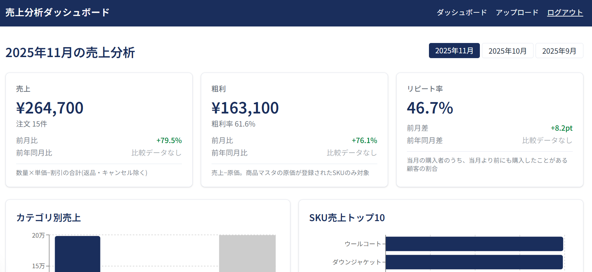
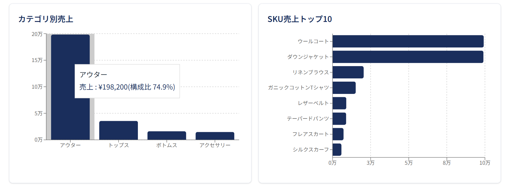
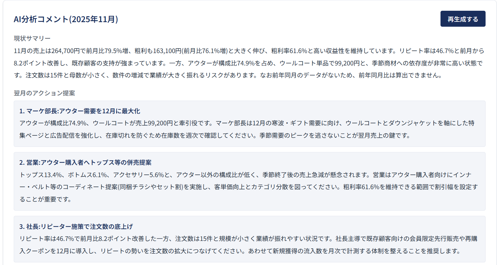

# 売上分析ダッシュボード

売上のCSVをアップロードするだけで、**月次の売上・粗利・リピート率**を自動で集計し、グラフと **AIの分析コメント(翌月のアクション提案つき)** を表示するWebアプリです。

> 学習用の模擬案件として作成したものです。同梱のサンプルデータはすべて架空のものです。

毎月、Excelでグラフを作り、コメントを書いていた作業(約3時間)を、CSVのアップロードと数クリックに置き換えることを目指しています。

## 画面イメージ

**KPIカード(売上・粗利・リピート率)**



**カテゴリ別売上とSKU売上トップ10**



**AI分析コメント(サマリーと翌月のアクション提案)**



## できること

| 機能 | 内容 |
|---|---|
| 3つのKPI | 売上 / 粗利 / リピート率。前月比・前年同月比つき |
| グラフ | カテゴリ別売上、SKU別売上トップ10 |
| 月の切り替え | データのある月をワンクリックで切り替え |
| AI分析コメント | 現状のサマリーと、翌月に取るべきアクション3件(コンサルのような文体) |
| CSVアップロード | Shopifyの注文CSV、または案件8のサンプル形式を自動判定して取り込み |
| ログインと権限 | 閲覧は承認されたメンバーのみ。アップロードとAI生成は「マーケ担当」のみ |

## 使い方

1. **ログイン**します(アカウントは管理者が作成します。下の「ユーザーの追加」参照)。
2. メニューの「アップロード」で、売上CSVを選んで **アップロード**。同じ注文は上書きされるので、何度上げても二重計上されません。
3. 「ダッシュボード」で月を選ぶと、KPIとグラフが見られます。
4. ページ下部の「**AIコメントを生成**」を押すと、分析コメントが作られます(1分ほどかかります)。

### 対応しているCSV

- **案件8のサンプル形式**: `order_date, customer_id, product_name, category, sku, quantity, revenue, cost`
  (`revenue` と `cost` は、その行の合計金額)。商品名・原価も同時に登録されるので、これだけで使えます。
  サンプル: [`case8-sales-sample.csv`](case8-sales-sample.csv)
- **Shopifyの注文エクスポートCSV**: 粗利を出したいときは、先に商品マスタ(列: `SKU, 商品名, カテゴリ, 原価`)を登録します。

文字コードは UTF-8 / Shift_JIS に対応。10MBまで。

### 数字の見方

- **売上**: 数量 × 単価 − 割引(返品・キャンセルは除く)
- **粗利**: 売上 − 原価。原価が分からない商品は計算から外し、画面に警告を出します
- **リピート率**: 当月の購入者のうち、当月より前にも購入したことがある人の割合。過去の履歴がない月は「算出不可」

## システムの特徴

- **お客様の個人情報を持たない**: メールアドレスや顧客IDは、元に戻せない形(ハッシュ)にして保存します。
- **AIの数字を検算する**: AIには集計済みの数値だけを渡し、AIが根拠として引用した数値が実際の集計と合っているかをプログラムで確認します(合わなければ作り直し。本文中の数値までは検証しません)。
- **費用を抑える仕組み**: AIの生成は、失敗も含めて全体で24時間に5回まで。月額数千円以内を想定しています。
- **データの安全**: データベース側でも「誰が何を読み書きできるか」を制限(RLS)しています。

## 技術構成

Next.js 16(React 19・TypeScript) / Supabase(認証・データベース) / Claude API(分析コメント。既定は `claude-sonnet-5-5`) / Recharts(グラフ) / Vercel(公開) / GitHub Actions(型チェック・Lint・ビルド)

## 開発者向け:ローカルで動かす

必要なもの: Node.js 20以上、Supabaseのプロジェクト、(AIコメントを使う場合)AnthropicのAPIキー

```bash
npm install
cp .env.example .env.local   # 値を入力(下表)
npm run dev                  # http://localhost:3000
```

データベースは、`supabase/migrations/` のSQLを、ファイル名の順にSupabaseで実行して作ります。

| 環境変数 | 内容 |
|---|---|
| `NEXT_PUBLIC_SUPABASE_URL` / `NEXT_PUBLIC_SUPABASE_PUBLISHABLE_KEY` | SupabaseのURLと公開キー |
| `CUSTOMER_KEY_SECRET` | 顧客のハッシュ用の秘密鍵(32文字以上のランダム文字列)。**データを入れた後は変更しないこと**(リピート率が壊れます) |
| `ANTHROPIC_API_KEY` | AIコメント用(未設定だと生成ボタンがエラーになります) |
| `ANTHROPIC_MODEL` | (任意)使うモデル。既定は `claude-sonnet-5-5` |

### ユーザーの追加

Supabaseの管理画面で、ユーザーを作成したあと、`profiles` テーブルで次のように更新します。**承認しないと、何も見えません。**

- `approved` を `true` にする(閲覧できるようになる)
- アップロードとAI生成をさせたい人は、`role` を `marketer` にする

あわせて、Supabaseの「Allow new users to sign up」はオフにしてください(誰でも登録できてしまうため)。

### コマンド

```bash
npm test            # 単体テスト
npm run typecheck   # 型チェック
npm run lint        # Lint
npm run build       # 本番ビルド
```

## 既知の制限

- AIコメントの本文中の数値までは検証していません。実行前に内容をご確認ください。
- 通貨は円のみ。日次・週次の集計、Shopify APIの直接連携は未対応です。
